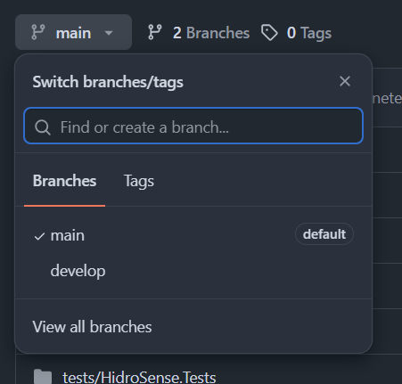
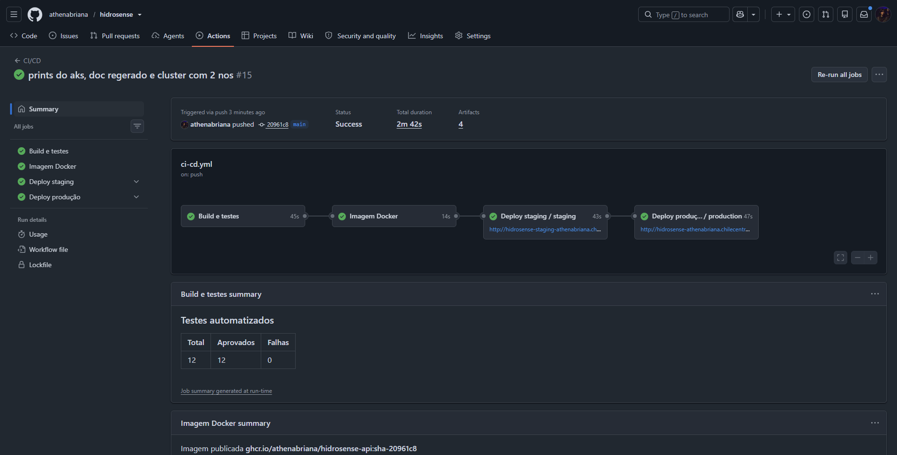
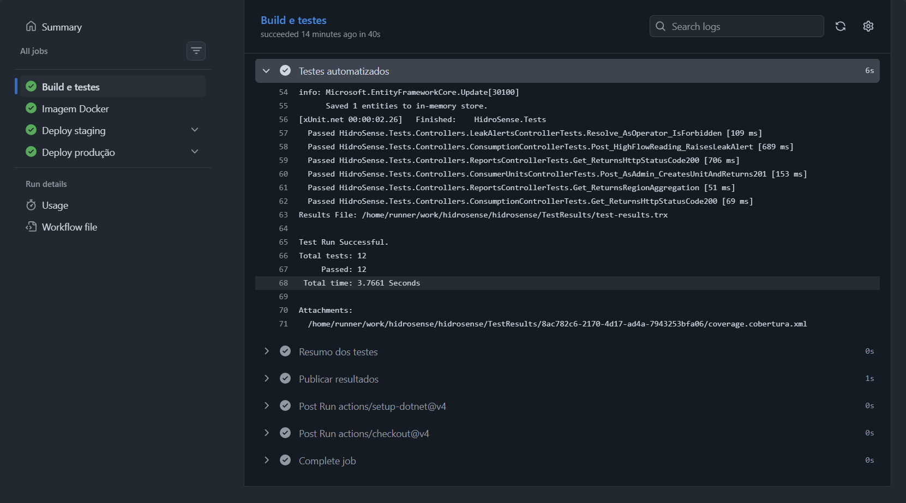
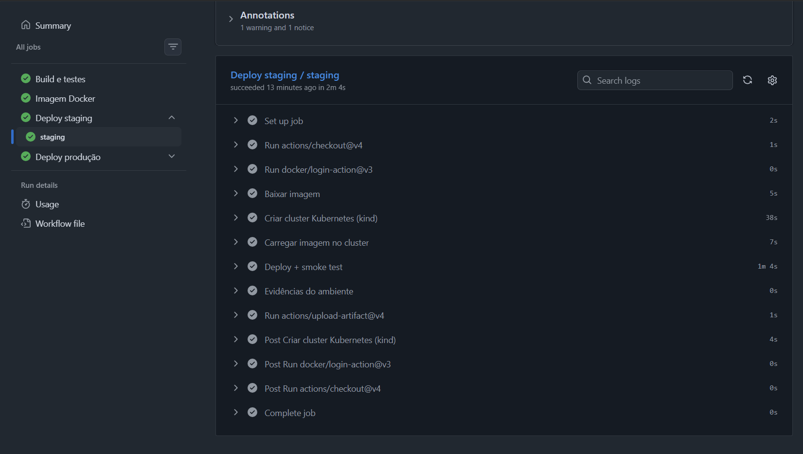
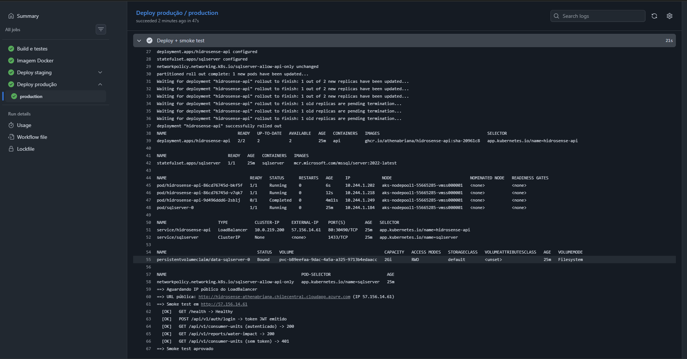
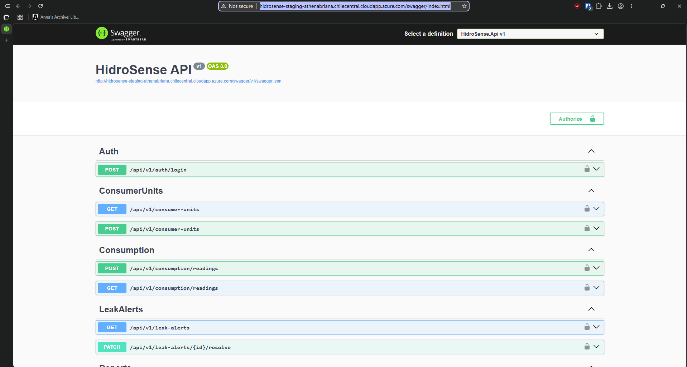
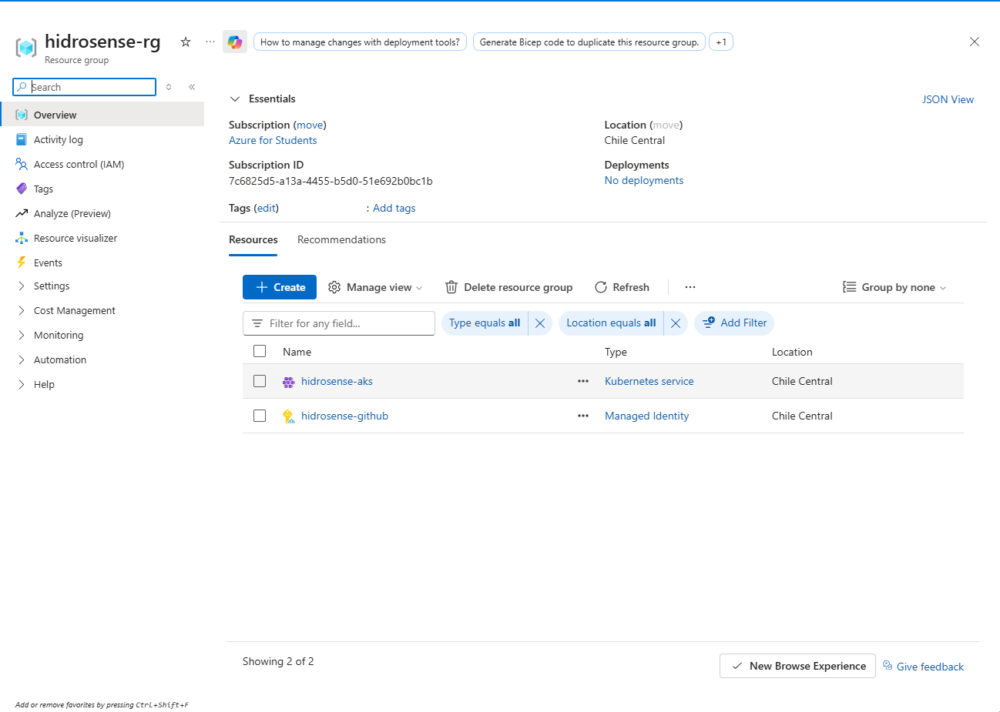
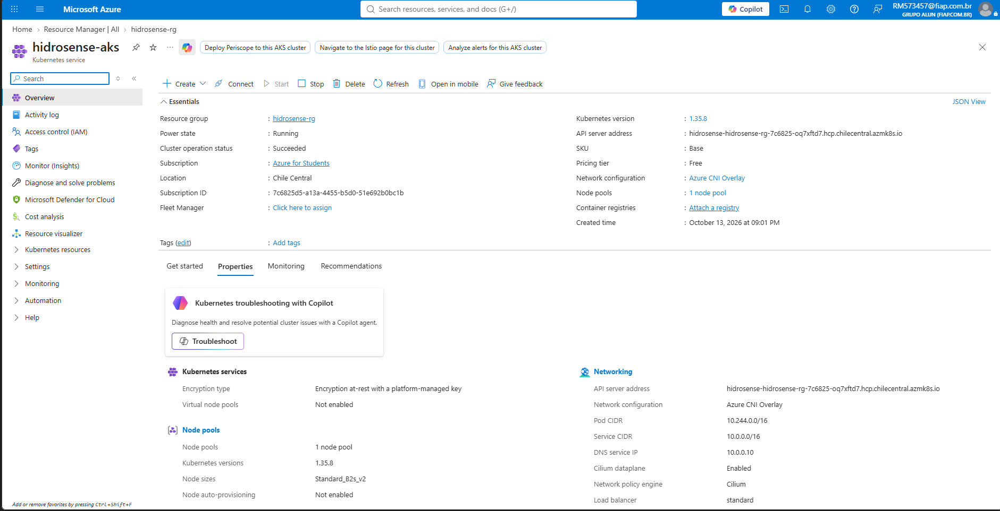
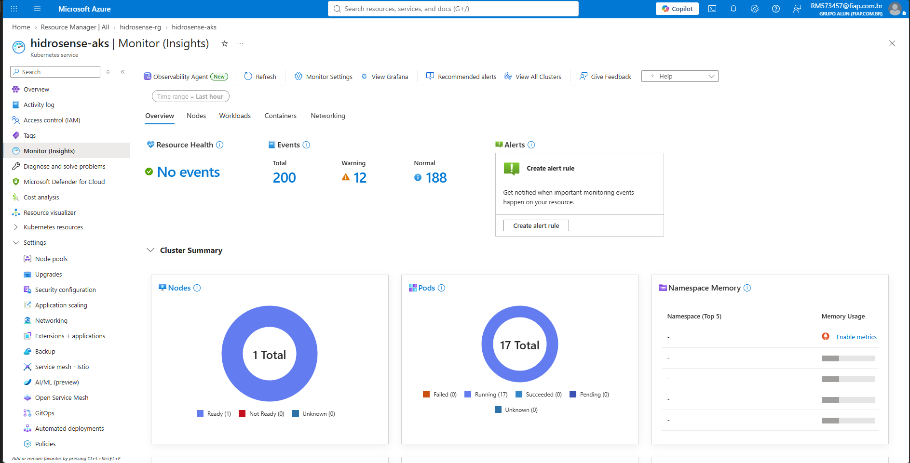

# Projeto - Cidades ESGInteligentes

**Integrantes:** Athena Briana da Costa Freitas (RM 573457) e Gabriel Vasconcelos Auzier (RM 565926)

**HidroSense**: API REST em ASP.NET Core 8 para monitoramento de consumo de água e detecção de vazamentos em unidades consumidoras (residenciais, comerciais, industriais e públicas). Atende ao eixo ambiental do ESG: reduzir desperdício hídrico com alertas de vazamento e relatórios de impacto.

O repositório leva a aplicação a um fluxo DevOps completo: build e testes automatizados, imagem Docker publicada no GitHub Container Registry e deploy automatizado em **staging** e **produção** num cluster **Kubernetes na Azure (AKS)** via GitHub Actions. Localmente, tudo roda com Docker Compose.

| Ambiente | URL |
|---|---|
| Staging | http://hidrosense-staging-athenabriana.chilecentral.cloudapp.azure.com/swagger |
| Produção | http://hidrosense-athenabriana.chilecentral.cloudapp.azure.com/health |

```
HidroSense/
├── .github/workflows/
│   ├── ci-cd.yml               # pipeline: build → testes → imagem → staging → produção
│   └── deploy.yml              # deploy reutilizável no AKS (um ambiente por chamada)
├── Dockerfile                  # build multi-stage (.NET SDK → ASP.NET runtime)
├── docker-compose.yml          # execução local: API + SQL Server, volume e redes
├── .env.example                # variáveis de ambiente (sem segredos)
├── k8s/
│   ├── base/                   # Deployment da API, StatefulSet do SQL Server, Services, NetworkPolicy
│   └── overlays/
│       ├── staging/            # namespace hidrosense-staging
│       └── production/         # namespace hidrosense-production (2 réplicas, limites)
├── scripts/
│   ├── azure/setup.sh          # cria o AKS e conecta o GitHub (OIDC, variáveis e secrets)
│   ├── azure/teardown.sh       # remove tudo da Azure
│   ├── k8s-deploy.sh           # deploy de um ambiente + smoke test
│   └── smoke-test.sh           # validações pós-deploy
├── src/HidroSense.Api/         # código-fonte da API
├── tests/HidroSense.Tests/     # testes de integração (xUnit + WebApplicationFactory)
└── docs/                       # documentação (docx) e prints
```

## Como executar localmente com Docker

Pré-requisitos: Docker Desktop (ou Docker Engine) com Compose v2.24+.

1. Crie o arquivo de ambiente a partir do modelo e preencha os valores:

   ```bash
   cp .env.example .env
   ```

   | Variável | Descrição |
   |---|---|
   | `DB_PASSWORD` | senha do usuário `sa` do SQL Server (8+ caracteres, maiúscula, minúscula, número e símbolo) |
   | `JWT_SECRET_KEY` | chave de assinatura dos tokens JWT (mínimo 32 caracteres) |
   | `SEED_ADMIN_PASSWORD` / `SEED_OPERATOR_PASSWORD` | senhas dos usuários `admin` e `operator` criados no primeiro start |
   | `API_PORT` | porta exposta no host (padrão `8080`) |

   Para gerar valores fortes: `openssl rand -base64 48`.

2. Suba a stack (build da imagem + banco + migrations + seed):

   ```bash
   docker compose up -d --build --wait
   ```

3. Acesse:
   - Swagger: http://localhost:8080/swagger
   - Health check: http://localhost:8080/health

4. Autentique com `POST /api/v1/auth/login` (`admin` + o `SEED_ADMIN_PASSWORD` definido) e use o token no botão **Authorize** do Swagger.

5. Rode o smoke test contra o ambiente local (Git Bash/WSL/Linux):

   ```bash
   SEED_ADMIN_PASSWORD='<sua senha>' scripts/smoke-test.sh http://localhost:8080
   ```

6. Encerre (`-v` apaga também o volume do banco):

   ```bash
   docker compose down
   ```

Sem Docker, só os testes: `dotnet test HidroSense.sln`.

## Pipeline CI/CD

**Ferramentas:** GitHub Actions, GitHub Container Registry (GHCR), GitHub Environments (`staging` e `production`) para os segredos de cada ambiente, e Azure Kubernetes Service (AKS) como destino do deploy.

```
pull request ─► Build ─► Testes
push develop ─► Build ─► Testes ─► Imagem Docker ─► Deploy staging
push main    ─► Build ─► Testes ─► Imagem Docker ─► Deploy staging ─► Deploy produção
```

| Etapa | Job | O que faz |
|---|---|---|
| Build | `build-test` | `dotnet restore` e `dotnet build -c Release` da solution |
| Testes | `build-test` | `dotnet test` com logger TRX e cobertura (coverlet); resumo no painel do run e resultados no artefato `test-results` |
| Imagem | `docker` | build multi-stage com cache do Buildx e push para `ghcr.io/athenabriana/hidrosense-api` com tags `sha-<commit>` e nome da branch |
| Deploy staging | `deploy-staging` → `deploy.yml` | login na Azure por OIDC, aplica `k8s/overlays/staging` no namespace `hidrosense-staging` do AKS, espera o `rollout status` e roda o smoke test no IP público |
| Deploy produção | `deploy-production` → `deploy.yml` | só na `main` e só se o staging passou; mesma imagem, overlay `k8s/overlays/production` (2 réplicas, limites de CPU/memória, sem Swagger) |

Funcionamento:

- **Mesma imagem nos dois ambientes.** O job `docker` publica uma única tag `sha-<commit>` e os dois ambientes usam essa imagem. O que muda entre eles é só configuração (overlay do kustomize e secrets).
- **Login sem senha da Azure.** O GitHub troca um token OIDC por acesso a uma identidade gerenciada que só tem permissão no cluster. Nenhuma credencial da Azure fica guardada no GitHub.
- **Rollout seguro.** `RollingUpdate` com `maxUnavailable: 0`; probes de startup, readiness e liveness em `/health` (que testa o banco), então um pod só recebe tráfego quando consegue falar com o SQL Server.
- **Smoke test como portão.** O deploy só passa se `/health` responder `Healthy`, o login emitir JWT, rotas autenticadas responderem `200` e rotas sem token responderem `401`. Se staging falhar, produção não roda.
- **Segredos.** Cada environment tem os secrets `DB_PASSWORD`, `JWT_SECRET_KEY`, `SEED_ADMIN_PASSWORD` e `SEED_OPERATOR_PASSWORD`, criados pelo `scripts/azure/setup.sh` e mascarados nos logs. Nenhum segredo fica no repositório.
- **Evidências.** Cada deploy publica o artefato `deploy-<ambiente>-logs` (recursos do namespace, `describe`, logs dos pods, eventos e saída do smoke test), um resumo no painel do run e o link do ambiente.

### Infraestrutura na Azure

`scripts/azure/setup.sh` (Git Bash, depois de `az login` e `gh auth login`) cria:

- resource group `hidrosense-rg` e cluster AKS `hidrosense-aks` (tier free, 2 nós `Standard_B2s_v2` em Chile Central, rede Azure CNI overlay com Cilium, que aplica a NetworkPolicy);
- identidade gerenciada `hidrosense-github` com credenciais federadas para os environments `staging` e `production` e o papel *Azure Kubernetes Service Cluster User Role* no cluster;
- variáveis do repositório (`AZURE_CLIENT_ID`, `AZURE_TENANT_ID`, `AZURE_SUBSCRIPTION_ID`, `AZURE_REGION`, `AKS_RESOURCE_GROUP`, `AKS_CLUSTER_NAME`) e os secrets de cada environment. As senhas geradas ficam também em `.env.azure`, fora do git.

`scripts/azure/teardown.sh` apaga o resource group inteiro. Sem a variável `AZURE_CLIENT_ID`, o pipeline continua rodando build, testes e imagem, e pula os deploys.

Para ver os ambientes pelo terminal:

```bash
az aks get-credentials -g hidrosense-rg -n hidrosense-aks
```

```bash
kubectl get pods,svc,pvc -n hidrosense-staging
```

```bash
kubectl get pods,svc,pvc -n hidrosense-production
```

## Containerização

`Dockerfile`:

```dockerfile
# ---- build: restore with cached layers, then publish ----
FROM mcr.microsoft.com/dotnet/sdk:8.0 AS build
WORKDIR /src

COPY src/HidroSense.Api/HidroSense.Api.csproj src/HidroSense.Api/
RUN dotnet restore src/HidroSense.Api/HidroSense.Api.csproj

COPY src/ src/
RUN dotnet publish src/HidroSense.Api/HidroSense.Api.csproj -c Release -o /app/publish /p:UseAppHost=false --no-restore

# ---- runtime: slim ASP.NET image, non-root user ----
FROM mcr.microsoft.com/dotnet/aspnet:8.0 AS runtime
WORKDIR /app

# curl is only used by the container HEALTHCHECK.
RUN apt-get update \
    && apt-get install -y --no-install-recommends curl \
    && rm -rf /var/lib/apt/lists/*

COPY --from=build /app/publish .

ENV ASPNETCORE_URLS=http://+:8080 \
    ASPNETCORE_ENVIRONMENT=Production \
    DOTNET_RUNNING_IN_CONTAINER=true

EXPOSE 8080
USER $APP_UID

HEALTHCHECK --interval=15s --timeout=5s --start-period=30s --retries=5 \
    CMD curl -fsS http://localhost:8080/health || exit 1

ENTRYPOINT ["dotnet", "HidroSense.Api.dll"]
```

Estratégias adotadas:

- **Multi-stage build:** o SDK (~800 MB) só existe no estágio de build; a imagem final usa o runtime ASP.NET.
- **Cache de camadas:** o `.csproj` é copiado e restaurado antes do código, então mudanças no código não refazem o `restore`. No CI, o cache do Buildx (`type=gha`) é reaproveitado entre execuções.
- **Usuário não-root:** a aplicação roda com o usuário `app` (`$APP_UID`) da imagem oficial.
- **Health check:** endpoint `/health` verifica a conexão com o banco; o Docker, o `docker compose --wait` e as probes do Kubernetes usam esse sinal.
- **`.dockerignore`:** exclui `bin/`, `obj/`, `.git`, `.env*` e documentação do contexto de build.
- **Configuração por ambiente:** nenhum segredo na imagem; tudo entra por variáveis (`ConnectionStrings__DefaultConnection`, `Jwt__SecretKey`, `Seed__*`). A aplicação recusa subir se faltar a chave JWT ou as senhas de seed.

Orquestração com Kubernetes (`k8s/`, kustomize), usada em staging e produção:

| Recurso | Uso |
|---|---|
| `Deployment hidrosense-api` | API com probes em `/health`, usuário não-root, requests/limits; 1 réplica em staging, 2 em produção |
| `StatefulSet sqlserver` | SQL Server 2022 com `PersistentVolumeClaim` de 2 Gi (disco gerenciado da Azure em `/var/opt/mssql`) |
| `Service` | `hidrosense-api` (LoadBalancer com IP e DNS públicos, porta 80 → 8080) e `sqlserver` (headless, 1433, só interno) |
| `ConfigMap hidrosense-config` | `ASPNETCORE_ENVIRONMENT` e nível de log por ambiente (gerado pelo kustomize; o hash no nome força rollout quando muda) |
| `Secret hidrosense-secrets` | connection string, chave JWT, senha do banco e de seed; criado pelo `k8s-deploy.sh` a partir dos secrets do environment, nunca versionado |
| `NetworkPolicy` | só pods da API alcançam o SQL Server na porta 1433 |
| Namespaces | `hidrosense-staging` e `hidrosense-production` isolam os ambientes no mesmo cluster |

Orquestração com Docker Compose (`docker-compose.yml`), usada localmente:

| Recurso | Uso |
|---|---|
| Serviços | `api` (HidroSense) e `sqlserver` (SQL Server 2022) |
| Volume | `sqlserver-data` persiste `/var/opt/mssql` entre restarts |
| Redes | `backend` (interna, sem saída externa: só a API alcança o banco) e `frontend` (expõe a API) |
| Variáveis | lidas do `.env`; as obrigatórias falham cedo com mensagem clara |
| Dependência | `api` só sobe quando o `sqlserver` está `healthy` |

## Prints do funcionamento

As imagens ficam em [`docs/prints/`](docs/prints/). As execuções completas estão na aba **Actions** do repositório.

| Evidência | Print |
|---|---|
| Branches `develop` (staging) e `main` (produção) |  |
| Pipeline completo (todos os jobs verdes) |  |
| Build e testes |  |
| Deploy em staging (AKS) + smoke test |  |
| Deploy em produção (AKS) + smoke test |  |
| Staging no ar (Swagger) |  |
| Resource group na Azure |  |
| Cluster AKS (visão geral) |  |
| Cluster AKS (monitoramento) |  |

## Tecnologias utilizadas

- **Aplicação:** C# 12, .NET 8, ASP.NET Core Web API, Entity Framework Core 8 (SQL Server), FluentValidation, JWT Bearer, Swagger (Swashbuckle)
- **Banco de dados:** Microsoft SQL Server 2022
- **Testes:** xUnit, Microsoft.AspNetCore.Mvc.Testing (WebApplicationFactory), EF Core InMemory, coverlet
- **Containers:** Docker (multi-stage), Docker Compose v2
- **Orquestração:** Kubernetes, kustomize, Azure Kubernetes Service (AKS)
- **Nuvem:** Microsoft Azure (AKS, Load Balancer, Managed Disks, Managed Identity), Azure CLI
- **CI/CD:** GitHub Actions, GitHub Container Registry, GitHub Environments, OIDC
- **Scripts:** Bash (setup da Azure, deploy e smoke test), kubectl, curl

## Checklist de entrega

| Item | OK |
|---|---|
| Projeto compactado em .ZIP com estrutura organizada | ☐ |
| Dockerfile funcional | ☐ |
| docker-compose.yml ou arquivos Kubernetes | ☐ |
| Pipeline com etapas de build, teste e deploy | ☐ |
| README.md com instruções e prints | ☐ |
| Documentação técnica com evidências (PDF ou PPT) | ☐ |
| Deploy realizado nos ambientes staging e produção | ☐ |
